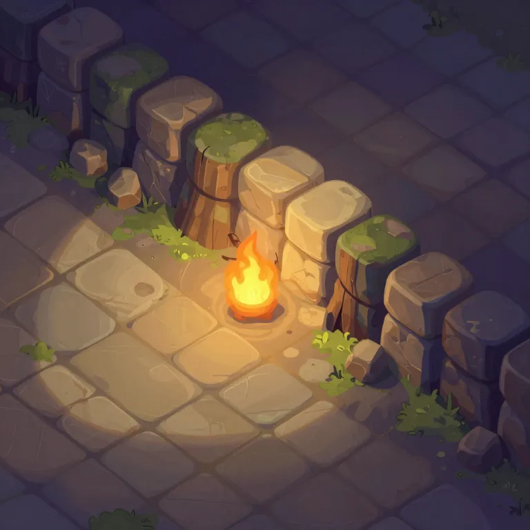
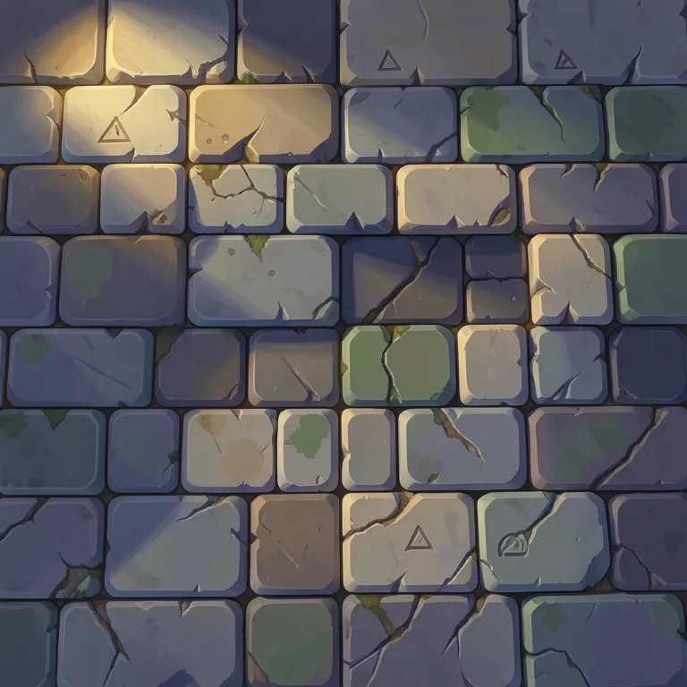
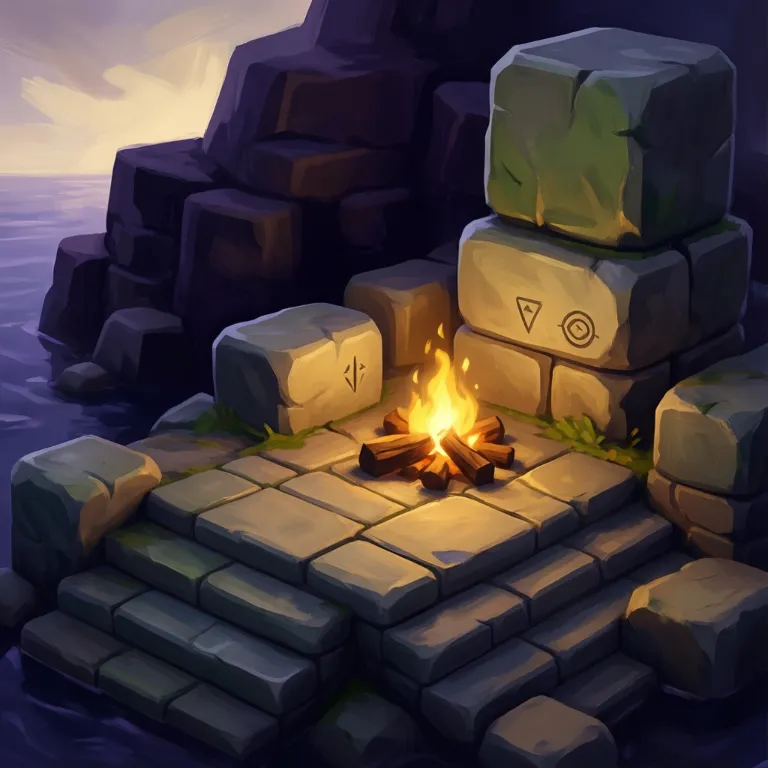
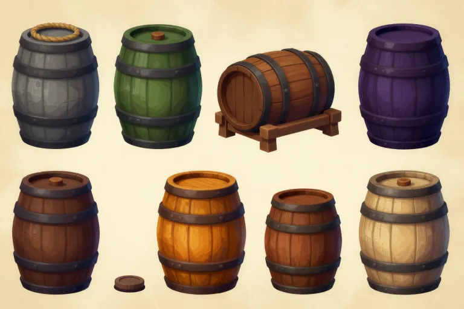
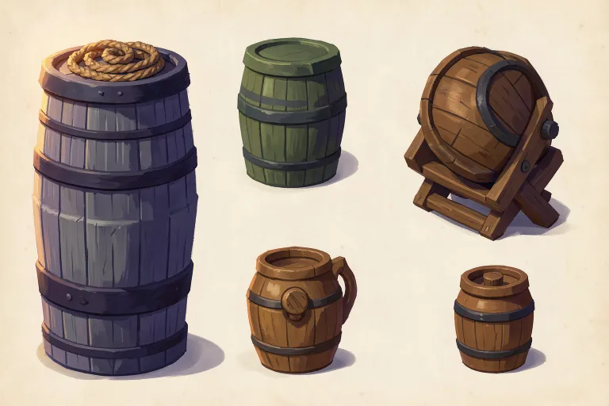
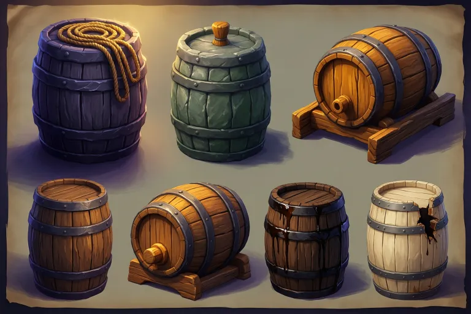
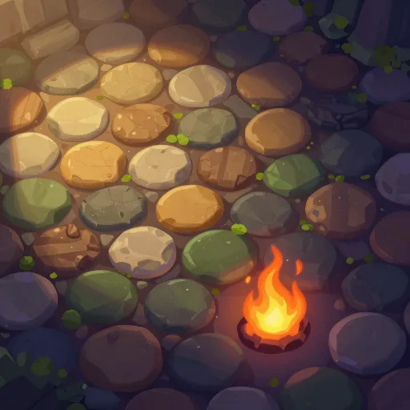
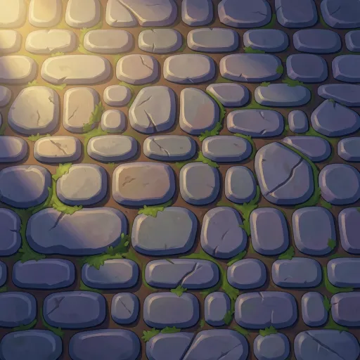
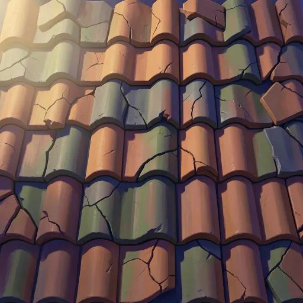

# Local image model bake-off (mflux on the Mac Studio)

2026-11-27, bead mw-e37.435. The question: which open-weight model should `pnpm asset:gen-image` use by
default, so image generate beads run on our own machine instead of paid APIs?

## Setup

- Machine: Mac Studio, M5 Ultra, 256 GB unified memory. mflux 0.24.0 (MLX), installed with `uv tool install`,
  weights in `~/llm/imagegen/hf` (assets/prompts/README.md, Tooling).
- All three models are Apache-2.0 and not gated on their Hugging Face cards (checked 2026-11-27). mflux pins
  each repo to a commit, recorded in every `vN.json`.
- Same three committed prompt files on every model, one image each, seed 42, run through the runner itself
  (so each prompt opens with the verbatim style-bible §14 preamble plus its §14.1 add-on; the runner drops the
  `REFERENCE IMAGES:` line because local models take no reference images):
  - tileable texture: `assets/prompts/texture/tex-stone-breakwater-01.md` (1024×1024)
  - environment concept: `assets/prompts/environment/env-gilded-tern-deck-01.md` (1536×864)
  - prop sheet: `assets/prompts/prop/prop-harbour-cask-set-01.md` (1536×1024)
- Timings are wall-clock for the whole `mflux` process (load, encode, sample, decode), with weights already
  downloaded and in the page cache. The first-ever run of a model adds the download and is not counted.
- 8-bit quantisation for all three. Images below are 768 px WebP copies; the originals are outside the repo.

## Results

| Model (steps) | Texture | Environment | Prop sheet | Peak memory |
|---|---|---|---|---|
| `z-image-turbo` (9) | 10.4 s | 12.7 s | 14.4 s | 26 GB |
| `flux2-klein-4b` (4) | 4.0 s | 4.7 s | 5.2 s | 9.7 GB |
| `qwen-image` = Qwen-Image-2512 (25) | 90.1 s | 134.9 s | 153.6 s | 37 GB |

Briar Glen proving batch (8 tileables and trims, 2 seeds each, same prompts on both models): Z-Image-Turbo
averaged 13.1 s per image, FLUX.2-klein-4b 3.7 s.

### Tileable texture: `tex-stone-breakwater-01`

| Z-Image-Turbo | FLUX.2-klein-4b | Qwen-Image |
|---|---|---|
|  |  |  |
| A scene, not a surface: a camp fire, a wall in perspective. | A flat block surface with mason's marks; the only usable texture. Baked light streak top left. | A scene: steps, a camp fire, sea behind. Mason's marks drawn well. |

### Environment concept: `env-gilded-tern-deck-01`

| Z-Image-Turbo | FLUX.2-klein-4b | Qwen-Image |
|---|---|---|
|  |  |  |
| Wrong viewpoint (looks at another ship from a quay), a magic glow orb nobody asked for. | Good painterly frame, but a timber village, not Wendmouth's stone quays. | Closest to the brief: on deck, the companionway hutch with its grating, rope coils on the rail, stone quays and a crane behind. Too dark and saturated. |

### Prop sheet: `prop-harbour-cask-set-01`

| Z-Image-Turbo | FLUX.2-klein-4b | Qwen-Image |
|---|---|---|
|  |  |  |
| Clean grid on parchment, but generic barrels coloured from the preamble palette (green, purple); none of the systemic cues. | Five items, one a tankard; loose layout. | Seven props with the cues: rope coil on the lid, cradled cask, glossy oil drips, pale cracked breakable barrel. Background is a grey board, not flat parchment. |

### Briar Glen cobbles, same prompt

| Z-Image-Turbo v1 | FLUX.2-klein-4b v3 | FLUX.2-klein-4b, loose tiles v3 |
|---|---|---|
|  |  |  |

## Findings

1. **The preamble is long for local text encoders.** Preamble + add-on + brief is over 512 tokens. mflux warns
   that Z-Image-Turbo ignores text past 512 tokens, so the brief's last lines (palette, wear, systemic cues) are
   cut. Qwen-Image reads the whole block and is the only model that drew every systemic cue on the prop sheet.
2. **Models take the preamble literally.** "Golden hearth light", "hearth amber" and "fire" make Z-Image-Turbo
   and Qwen-Image paint camp fires into textures and floors (7 of the 8 Z-Image Briar candidates checked by eye have a fire or
   lantern in them). "Soft warm key light from the upper left" bakes a light streak into every texture, which
   the tileable checklist forbids. FLUX.2-klein-4b is the least literal of the three.
3. **gpt-image still wins on fidelity.** None of the local outputs would pass the style-bible checklist as-is
   for shipping. They are good enough for drafts, concept exploration and series iteration at no cost.

## Recommendation

- **Tileable textures and trims: `flux2-klein-4b`** (the runner's default for the Tileable texture category).
  About 4 s an image, so generate 8–16 seeds per asset and pick. Expect to reject for baked light.
- **Prop sheets, environment and other concepts: `qwen-image`** (the runner's default for every other
  category). 1.5–2.5 min an image; it follows long, many-part briefs.
- **`z-image-turbo`: available, not a default.** Fast, but it truncates our prompts and literalises the mood
  line.
- Follow-up for the style bible (filed as a bead): the §14 preamble's lighting sentence conflicts with the §14.1
  tileable add-on ("flat even lighting"). A texture variant of the preamble, or moving the lighting sentence into
  the non-texture add-ons, would fix the baked-light failures on every model, gpt-image included.
