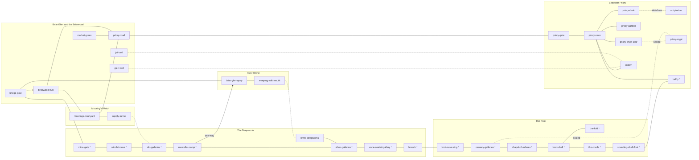

# The dungeon network

"One fantastic dungeon with interconnected systems beats ten generic dungeons" (CONSTITUTION). This is the master plan for the Deepworks, Bellwater Priory and the Knot (mw-e26.1): which areas exist, how they join, what the critical path is, where the six MVP puzzles sit, how the pace runs, and what each ending does to the level. The Priory blockout (mw-e26.5), the Deepworks (mw-e26.2), the Knot (mw-e26.9) and the forest-loop legs (mw-e25.25) build from it.

It is data first: [`dungeon.json`](dungeon.json) holds the areas, routes, puzzles, pacing, respawn rules and ending tables below, and `src/content/dungeon.test.ts` proves them against [`connectivity.json`](../../src/content/data/world/connectivity.json) (the area graph), the puzzle and fact registries, the class files and the [route matrix](route-matrix.md). Canon is the [story bible](../narrative/story-bible.md) (§3.5 places, §4.1 beats, §4.2 the Warden, §4.4 endings, §4.5 failure). Anything the bible does not say is a **PROPOSAL** and is listed under "Open questions for the owner".

Area ids are connectivity node ids. The class routes named below are the route matrix's, several of which are still `proposal` there and share its owner review.

## Area graph

Solid lines are open paths and doors, dotted lines are shortcuts and secrets, `*` marks the critical path (the main-quest waypoints of `connectivity.json`).

The Knot has two land entries from outside and one from the priory: the **breach** (Deepworks to Outer Ring), the **Sounding Shaft** (belfry to the shaft's foot, a door from the Cradle) and the **crypt** (sealed until broken from the Knot side). The Cradle is therefore never behind a single door of the dungeon: it can be reached without crossing the Deepworks at all, and the Deepworks can be left without crossing the Knot's outer halls.

### Areas

`tier`: **critical** is on the main-quest path, **optional** is not, **approach** only connects. `intensity` feeds the pacing chart below.

| Area | Region | Tier | Intensity | Role | What it is |
| --- | --- | --- | --- | --- | --- |
| `mine-road` | Deepworks | approach | quiet | connector | Signposted road from Market Green to the gate (mw-e25.23). |
| `mine-gate` | Deepworks | critical | light | gate | Boarded gate; six ways in. |
| `winch-house` | Deepworks | critical | quiet | interior | First interior; the winch cage and the Bell Line rule. |
| `old-galleries` | Deepworks | critical | heavy | combat | Pillared halls; goblin patrols and Tallow Ooze. |
| `rootcellar-camp` | Deepworks | critical | quiet | social | Goblin camp; parley by default. |
| `silver-galleries` | Deepworks | critical | heavy | combat | Silver workings; Hollow patrols and mimics. |
| `vane-sealed-gallery` | Deepworks | critical | quiet | lore | Ledger, horn-ring, the breach. |
| `breach` | Deepworks | critical | light | transition | The hole into the Knot. |
| `lower-deepworks` | Deepworks | optional | light | puzzle | Flooded gallery; Frozen Channel. |
| `moorings-courtyard` | Mooring's Watch | optional | light | approach | Goblin lookout; the long way in. |
| `moorings-tower` | Mooring's Watch | optional | light | side quest | Sentinels, keeper's log, signal mirror. |
| `supply-tunnel` | Mooring's Watch | optional | quiet | approach | The collapsed tunnel into the upper mine. |
| `weeping-adit-mouth` | River | optional | quiet | approach | The river way in. |
| `priory-gate` | Priory | optional | quiet | gate | Head of the priory road (PROPOSAL). |
| `priory-nave` | Priory | optional | light | hub | Roofless nave; the priory hub. |
| `priory-choir` | Priory | optional | light | puzzle | Singing-monk statues; Watchers. |
| `scriptorium` | Priory | optional | light | lore | Pages and book mimics. |
| `priory-garden` | Priory | optional | quiet | lore | Dead pear tree; a dead end. |
| `priory-crypt-stair` | Priory | optional | quiet | puzzle | Sunbeam; the stair to the sealed crypt. |
| `priory-crypt` | Priory | optional | quiet | connector | Sealed from the priory side. |
| `cistern` | Priory | optional | light | connector | Glen Well and jail drain meet here. |
| `belfry` | Priory | critical | quiet | set piece | Cracked bell; Vespers. |
| `knot-outer-ring` | Knot | critical | heavy | combat | Runes, loom spiders; Scales. |
| `ossuary-galleries` | Knot | critical | light | puzzle | The Forgotten, Clatter; Dark Crossing. |
| `chapel-of-echoes` | Knot | critical | quiet | puzzle | Chimes and the portcullis trap. |
| `horns-hall` | Knot | critical | heavy | boss | Brother Horn. |
| `the-fold` | Knot | critical | quiet | rest | Sleepers' vault; dead end by design. |
| `sounding-shaft-foot` | Knot | critical | light | set piece | The Climb. |
| `the-cradle` | Knot | critical | heavy | boss | The abbot and the Hushlings. |

Graph additions for this plan (all planned, no scene yet; `world-map.md` lists them): nodes `priory-gate`, `priory-garden`, `priory-crypt-stair`; edges `priory-road-gate` and `priory-gate-nave` (replacing `priory-road-nave`), `nave-garden`, `nave-crypt-stair` and `crypt-stair-crypt` (replacing `nave-crypt`; the latter is unlocked by `world.priory-crypt.unsealed`, the fact that already opens `ossuary-crypt`), and an unlock `watchers.solved` on `choir-scriptorium` (the hidden choir door). The priory road to the priory gate edge and the ridge path from Mooring's Watch to the priory road (`moorings-priory-ridge`, mw-e25.25) are both on the map; the bible gives neither a gate nor a start point, so both are open questions.

## Critical path and optional areas

The critical path is the main quest's waypoint list, bible §4.1: the **mine gate**, **winch house**, **old galleries**, **Rootcellar camp**, **silver galleries**, **Vane's sealed gallery**, the **breach**, the **Outer Ring**, the **Ossuary**, the **Chapel of Echoes**, **Horn's Hall**, the **Fold**, the **Cradle**, the **Sounding Shaft's foot** and the **belfry**. It never needs an optional area. The priory is optional until the end: the player can see it early through the forest (beat 9) and the belfry is reached from the shaft's foot in Act III.

Optional areas are the priory's rooms (nave, choir, scriptorium, garden, crypt stair, cistern), Mooring's Watch and its tower, the lower Deepworks and the weeping adit, plus every shortcut below. They hold lore, shortcuts and the Watchers, Sunbeam and Frozen Channel puzzles.

## Macro-routes

A macro-route is a whole way from the town spawn (`bridge-post`) to the Cradle. The test walks each one over the real edges. `front-gate`, `supply-tunnel`, `weeping-adit` share the Knot's tail after the breach; `priory-shaft` and `ridge-shaft` do not touch the Deepworks or the Knot's outer halls at all.

| Route | Way | Status | Classes | Skips |
| --- | --- | --- | --- | --- |
| `front-gate` | Mine gate, winch house, old galleries, goblin camp, silver galleries, Vane's gallery, breach, Knot. | canon | all, plus a key for anyone | none |
| `supply-tunnel` | Briarwood, Mooring's Watch, the supply tunnel collapse, old galleries onward. | canon | any class | the gate and winch house |
| `weeping-adit` | Under the bridge, the quay, up the Weeping Adit into the lower Deepworks, silver galleries onward. | canon | any class (swim, raft or barge) | gate, winch house, old galleries, goblin camp |
| `priory-shaft` | Market Green, priory road, gate, nave, belfry, down the Sounding Shaft to its foot. | proposal | any class | the Deepworks and the Knot's outer halls |
| `ridge-shaft` | Briarwood hub, Mooring's Watch, the ridge path to the priory road, then the shaft. | proposal | any class | as `priory-shaft` |
| `priory-crypt` | Nave, crypt stair, crypt, Ossuary, chapel, hall. Opens once `world.priory-crypt.unsealed` is set. | canon | any class | the Deepworks and the Outer Ring |
| `glen-well` | Glen Well rung, cistern, nave, belfry, down the shaft. | canon | knight, archer, sorcerer, thief | as `priory-shaft` |

AC-2 asks for two ways to the Cradle. `front-gate` and `priory-shaft` use no edge in common, and cutting every edge of `front-gate` leaves the Cradle reachable; both facts are tested. `priory-shaft` is a proposal (open question 1), but the bible's own loop "the priory crypt and the Sounding Shaft join the labyrinth" (§3.1) already makes the shaft walkable; the owner's choice is only how soon it is open.

### Per-class macro-routes

Each class's best routes by the capability that opens them (route matrix, `src/content/data/class`). A route marked `needs` waits on a capability that is not in the registry yet.

| Class | Route | Capabilities | How |
| --- | --- | --- | --- |
| knight | `front-gate` | `technique.shoulder-barge` | Smash the rotted side-boarding. |
| knight | `supply-tunnel` | `technique.shoulder-barge` | Barge the rotten cribbing at the collapse. |
| knight | `priory-shaft` | `verb.climb.ledge` | Climb the bell-ropes and ledges. |
| knight | `glen-well` | `verb.climb.ledge` | Down the Glen Well rung into the cistern. |
| archer | `front-gate` | `arrow.pinning-shot` | Shoot the winch pulley so the cage drops. |
| archer | `weeping-adit` | `arrow.rope` | Anchor a rope across the flooded run. |
| archer | `priory-shaft` | `arrow.rope` | A rope line up the shaft skips half the climb. |
| archer | `supply-tunnel` | `arrow.rope` | Rope arrow over the collapse. |
| sorcerer | `front-gate` | `spell.mage-hand` | Mage Hand the inner bar. |
| sorcerer | `supply-tunnel` | `spell.firebolt` | Burn the cribbing that holds the fall. |
| sorcerer | `priory-shaft` | `spell.mage-hand` | Haul the counterweight chains into a stair. |
| sorcerer | `weeping-adit` | needs `spell.frostglass` (mw-e08) | Frostglass the current's edge. |
| thief | `front-gate` | `tool.lockpick` | Pick the padlock, or climb the vent chimney. |
| thief | `supply-tunnel` | `verb.climb.rough` | Squeeze up the cracked wall over the fall. |
| thief | `weeping-adit` | `verb.climb.rough` | Traverse the adit wall above the waterline. |
| thief | `priory-shaft` | `verb.climb.rough` | Free-climb the rough shaft wall. |

Every class has at least three macro-routes; none is the only way for its class, so no class is walled out of the Cradle.

## Puzzle placement

Puzzle mechanics are E15's; this fixes where each of the six MVP reference puzzles sits and what it does for the level. The `Key` column is the puzzle id (`src/content/data/puzzle`), also the scene id of its reference room.

| Puzzle | Key | Area | Tier | Reference puzzles | Role in the level |
| --- | --- | --- | --- | --- | --- |
| Sunbeam | `sunbeam-hall` | `priory-crypt-stair` | optional | e15-reference-puzzles-a | Light the sensor so the stair's sealed carving can be read. The crypt stays sealed from this side whatever the player does (PROPOSAL, question 3). |
| Frozen Channel | `frozen-channel` | `lower-deepworks` | optional | e15-reference-puzzles-a | Weigh the far pad across the flooded channel (Frostglass, rope or raft) for a cache behind the river entry (PROPOSAL). |
| Scales | `scales-room` | `knot-outer-ring` | critical | e15-reference-puzzles-b | Balance the plates to open the Hornfolk gate; the route matrix's `outer-ring-gate`. |
| Watchers | `watchers` | `priory-choir` | optional | e15-reference-puzzles-b | Face the statues to the altar; opens the hidden choir door (`choir-scriptorium`, fact `watchers.solved`). |
| Dark Crossing | `dark-crossing` | `ossuary-galleries` | critical | e15-reference-puzzles-b | Cross the Ossuary pit in the dark, or hum the hymn and follow Clatter; the route matrix's `ossuary-crossing`. |
| Chimes | `chimes` | `chapel-of-echoes` | critical | e15-reference-puzzles-b | Ring the bells in the order heard to settle the echoes; the route matrix's `chapel-of-echoes`. |

All three critical puzzles have an any-class puzzle solution and four class bypasses in the route matrix, so none is a hard lock. Two of the three optional puzzles are in the priory and the third on the river route, so the optional puzzles reward exploring the loops rather than blocking the path.

## Shortcuts

Every shortcut is an edge on the map; the first column is its id. Together they make the loops of bible §3.1 and give every class at least one ability-gated way (`world-map.md`).

| Edge | What it opens |
| --- | --- |
| `supply-tunnel-collapse` | Mooring's Watch supply tunnel into the old galleries; skips the gate and winch house. |
| `weeping-adit` | River mouth into the lower Deepworks; skips the gate, old galleries and the goblin camp. |
| `stone-stair` | Cutting hall down to the quay: a fast way out of the Deepworks (one-way). |
| `sleepers-path-mine-gate` | The Sleepers' Path to the gate, by a tracker's secret. |
| `glen-well-cistern` | The town to the priory by the Glen Well rung, the cistern and the nave. |
| `jail-drain` | The cell to the cistern and the priory (the failure route of §4.5). |
| `crypt-stair-crypt` | Nave to crypt, once the seal is broken (same fact as `ossuary-crypt`). |
| `ossuary-crypt` | Ossuary to the priory crypt: Horn's Befriend reward and the way out of the Knot. |
| `sounding-shaft` | Belfry to the shaft's foot: the Climb up, or the shaft descent down (question 1). |
| `choir-scriptorium` | The hidden choir door to the scriptorium; opened by the Watchers puzzle. |

## Encounter pacing

Rule (AC-4): between any two **heavy** (combat-heavy) areas on the critical path there is at least one **quiet** area, and consecutive areas are connected on the map. Light areas are breathers but do not count as quiet. The test checks the chart below against the graph and each area's intensity.

| # | Area | Intensity | What happens |
| --- | --- | --- | --- |
| 1 | `mine-gate` | light | Wolves, the barred gate and the choice of six ways in. |
| 2 | `winch-house` | quiet | Breathing room; mechanisms, the Bell Line rule. |
| 3 | `old-galleries` | heavy | First real fight: goblin patrols and Tallow Ooze. |
| 4 | `rootcellar-camp` | quiet | Parley by default; the goblins' account of the Big One. |
| 5 | `silver-galleries` | heavy | Hollow patrols and mimics. |
| 6 | `vane-sealed-gallery` | quiet | Ledger and horn-ring; the Knot's dread builds. |
| 7 | `breach` | light | The threshold; first sight of the Knot. |
| 8 | `knot-outer-ring` | heavy | First Forgotten and loom spiders; the Scales gate. |
| 9 | `ossuary-galleries` | light | Clatter and the Dark Crossing; fight optional if you hum. |
| 10 | `chapel-of-echoes` | quiet | The Chimes and the portcullis trap; no brawl. |
| 11 | `horns-hall` | heavy | The Warden encounter. |
| 12 | `the-fold` | quiet | The reveal: sleepers on moss beds. |
| 13 | `horns-hall` | quiet | Revisit: Horn resolved, the abbot's voice, Tansy rises. |
| 14 | `the-cradle` | heavy | The abbot and the Hushlings. |
| 15 | `sounding-shaft-foot` | light | The Climb: held or a chase, a traversal set piece. |
| 16 | `belfry` | quiet | Vespers. |

The heavy beats fall at 3, 5, 8, 11 and 14, never closer than two rooms apart, with a quiet room between each pair. Row 4 is quiet because the camp's default is a parley (bible 4.1 beat 6); a hostile camp makes it heavy for that save but the player chose it, and the gallery before and after still bracket it with quiet rooms (2 and 6). Row 13 is the Hall after Horn is resolved, so it is rated quiet.

## Fold respawn logic

Failure creates stories (bible §4.5): a death in the Knot is a place, not a reload. `region` is where the player died.

| Rule | Region | Wakes in | When | Source |
| --- | --- | --- | --- | --- |
| `knot-horn-alive` | Knot | `the-fold` | `horn.fate` = alive | canon: moss bed, a bandage you did not tie; each rescue adds to `horn.rescues` |
| `knot-horn-dead` | Knot | `rootcellar-camp` | `horn.fate` = dead, `goblins.standing` neutral or friendly | canon: Kettleback charges a carrying fee |
| `knot-horn-dead-goblins-hostile` | Knot | `ossuary-galleries` | `horn.fate` = dead, `goblins.standing` = hostile | canon: laid out by the Forgotten |
| `deepworks` | Deepworks | `rootcellar-camp` | goblins neutral or friendly | PROPOSAL: the same carrying fee, else the last save |
| `priory` | Priory | `sleeping-ox` | always | PROPOSAL: as the Briarwood; Juniper says where she found you |

`the-fold` has one door, `horns-hall-fold`, so the respawn point is always reachable and always safe: Horn's Hall is the only way back out. The five rules map onto the `respawn-rules` content (mw-e01.8, contextual wake-ups mw-e01.12) as region rules with fact conditions.

## Set pieces

| Set piece | Area | What it is |
| --- | --- | --- |
| The sour bell | `belfry` | Ringing the cracked bell without its tongue wakes every Forgotten in the priory and draws Hushlings up the shaft; Horn hears it and comes to you (§4.5). |
| Horn's Hall | `horns-hall` | The Warden encounter outside the Fold; every §4.2 resolution begins here. |
| The Cradle | `the-cradle` | The round chamber where the dream leaks into the physical; the abbot conducts. |
| The Climb | `sounding-shaft-foot` | The vertical ascent with the song rising behind (§4.1 beat 13). |
| Vespers | `belfry` | Hang the tongue and ring the bell; the song falters (§4.1 beat 14). |

## Endings: level state

Endings are assembled from world facts (bible §4.4). Each table lists the facts that **decide** the headline ending (`match` all, except where noted), the facts that **modify** it, and the **level variants**: what the named area looks like. `knot.breach-sealed` is the registered name of the bible's "breach sealed" (alias `breach.sealed`).

Facts the main quest data owns: `horn.fate`, `abbot.fate`, `vane.fate`, `knot.breach-sealed`, `tansy.saved`, `clatter.restored`, `goblins.standing`, `wendmouth.visited`, `bell-tongue.destroyed`. Two do not exist yet: `crate.intercepted` and `tern.sailed` (listed as pending), and one is a PROPOSAL, `bell.rung` (question 2), because no fact says whether the bell was rung.

### Vespers Rung

Decides: `horn.fate` = alive, `abbot.fate` = at-rest or defeated, `bell.rung` = true. Modifies: `knot.breach-sealed`, `clatter.restored`, `goblins.standing` friendly, `tansy.saved`, `vane.fate`, `bell-tongue.destroyed`.

| Area | Variant |
| --- | --- |
| `mine-gate` | The town brings bread to the gate; Horn's lantern burns in the winch house window. |
| `belfry` | The bell rings each dusk; the goblins, Hale or Tansy pull the rope. A recast clapper hangs where the tongue was if `bell-tongue.destroyed`. |
| `breach` | If `knot.breach-sealed`: frozen and shored, or walled by goblins; the song never reaches the town again. |
| `the-fold` | Empty and swept; Horn keeps the moss beds. |
| `ossuary-galleries` | If `clatter.restored`: Clatter walks the halls humming. |

### The Last Warden

Decides: `horn.fate` = dead, `bell.rung` = true, `vane.fate` exposed, confessed or fled. Modifies: `goblins.standing`, `clatter.restored`, `knot.breach-sealed`, `tansy.saved`, `bell-tongue.destroyed`.

| Area | Variant |
| --- | --- |
| `horns-hall` | Empty: no Warden; Horn's horn is the player's item. |
| `rootcellar-camp` | If goblins friendly: the clan takes up the watch in its own way. |
| `ossuary-galleries` | If `clatter.restored`: Clatter walks the halls humming; otherwise no one does. |
| `mine-gate` | If goblins hostile: the last slide is a lantern at the gate and a child's footprints going in. |
| `belfry` | The bell is rung; the sleepers come home and the bounty is paid. |

### The Hireling's Silence

Decides: `vane.fate` = bribed-player, `knot.breach-sealed` = false, `bell.rung` = true. Modifies: `horn.fate`, `tansy.saved`, `wendmouth.visited`, `bell-tongue.destroyed`.

| Area | Variant |
| --- | --- |
| `breach` | Left open: Vane's tunnel keeps running silver and Hornfolk gold from below the Line. |
| `mine-gate` | The gate stands open and busy; the mine prospers. |
| `belfry` | The bell is rung, mostly; the rope is worn thin. |
| `vane-sealed-gallery` | Ledger buried: the strongbox is empty. |

### The Long Vespers

Decides (`match` any): `abbot.fate` = joined, or `bell.rung` = false. Modifies: `tansy.saved` false (hostage), `horn.fate`, `goblins.standing`, `bell-tongue.destroyed`.

| Area | Variant |
| --- | --- |
| `the-cradle` | The player wakes here years later; the abbot is gone and a goblin pokes them with a stick: "Fix it." |
| `belfry` | The bell stays silent; the tongue is gone or never hung. |
| `the-fold` | The sleepers sleep on, snoring. |
| `mine-gate` | Nobody comes to the gate; the town is asleep. |

### Harbour facts

`wendmouth.visited`, `crate.intercepted` and `tern.sailed` add epilogue slides and **never** decide a headline ending (bible §4.4; the tests check that none appears in a `decides` list): visiting Wendmouth adds slides, an intercepted crate sends the name-stone home to the Knot, and a sailed Tern ends on a man in a far city finding a tiny ox asleep on every coin.

## Open questions for the owner

1. **Is the Sounding Shaft walkable down from the belfry before Act III?** The bible's loop (§3.1) joins the priory and the Knot by the shaft, so the data lets a player descend it. The proposal (`priory-shaft`, `ridge-shaft`, `glen-well`) is to allow it as a rope-down arrival at the shaft's foot, one door from the Cradle, giving the Cradle its second route. The cost is that a player can skip the Deepworks and Horn; the quest layer would need the Cradle encounter to demand its Act III facts. If no, drop the three routes and AC-2 then needs another way in (a second Knot entry, or the crypt open from the start).
2. **Does a "bell rung" fact exist?** The endings need to tell Vespers Rung from The Long Vespers ("failed to ring the bell", §4.4). `bell-tongue.destroyed` only says the tongue is gone (a recast fixes it). The table proposes `bell.rung`; the main quest data owns the real name.
3. **What does the Sunbeam puzzle give?** The bible places no puzzle in the crypt stair. The proposal makes it optional, lore only, with the crypt sealed from this side whatever the player does (`crypt-stair-crypt` follows `world.priory-crypt.unsealed`). If the owner wants Sunbeam to open the crypt from the priory side, the edge's unlock changes to `sunbeam-hall.solved`; that contradicts bible §4.1 beat 9 ("the crypt door is sealed from the other side").
4. **Is there a priory gate?** The bible names the priory road and the nave, nothing between. The proposal adds `priory-gate` (mw-e26.5 says "priory road gate") with `priory-road-gate` and `priory-gate-nave`.
5. **Where does the ridge path from Mooring's Watch leave the watch?** The edge `moorings-priory-ridge` exists (mw-e25.25), the bible gives no start (also in `world-map.md`).
6. **Where do deaths in the Deepworks and the priory wake the player?** Only the Knot and the Briarwood are canon (§4.5). The proposal wakes Deepworks deaths at the goblin camp (or the last save with hostile goblins) and priory deaths at the Sleeping Ox.
7. **Frozen Channel's reward.** The bible gives the puzzle no home; it is placed in the flooded lower Deepworks guarding a cache; what the cache holds is open.
8. **Alias of the breach fact.** The registry has `knot.breach-sealed`; the brief and bible text say "breach sealed". If the main quest renames it, the endings table follows.
