# World map

The plan every level bead builds from (mw-e24.1). It is data first: [`src/content/data/world/connectivity.json`](../../src/content/data/world/connectivity.json) (schema: [world-schema](../content/world-schema.md)) holds the nodes, edges and loops below, `pnpm world:validate` proves it (CI job `world-validate`), and this page explains it. Canon is story bible §3.1 (the region), §3.5 (locations), §3.6 (Wendmouth) and §4.1 (the beat sheet); every name below is the bible's.

"Small world with surprising density" (CONSTITUTION): paths loop together and reveal shortcuts as the player gains abilities. The map keeps that promise in three ways: ten loops (below), at least one ability-gated shortcut per class, and a main quest that never needs anything optional.

## Reading the map

- **Node**: a place. `scene` set means built (green in the diagram); otherwise planned. `optional` marks places the main quest never needs (Wendmouth, Kestrel Lock).
- **Edge kinds**: `path` (always open), `door` (a threshold, may be gated), `shortcut` (a loop-closing route the player opens; needs an `unlock`), `one-way` (only from `from` to `to`), `secret` (hidden until found). Every kind except `one-way` is walkable both ways.
- **Unlock**: a condition in the shared fact condition language (`src/sim/facts`, [conditions](conditions.md)), e.g. `{ "fact": "world.glen-well.rung-pulled" }`. Facts are declared in `src/content/data/fact/` (the `world` group holds the ones this map adds).
- **Routes and classes**: `routes` lists capabilities that can open an edge (any one). `classesHint` is the classes whose `mvpCapabilities` (src/content/data/class) include a route; load fails if it disagrees with the class files. An edge with **no routes** is opened by an outcome anyone can cause (a quest step, a puzzle, a raft), not a class ability.
- **Time**: `time` names clock phases (`game.clock.phases`, mw-e27.12); the barge runs in `dawn` and `day` ("mornings"). There is no real-time clock for Wendmouth (bible §3.6).
- **Reachability rule (AC-1)**: from the town spawn (`bridge-post`, where everything from the valley arrives), using only edges all four base classes can take, every node must be reachable. Class-gated edges therefore only ever close loops; they never gate a place.

## Diagram

Solid lines are paths and doors, dotted lines are shortcuts and secrets (labelled with the classes whose capabilities open them), arrows are one-way.

```mermaid
flowchart LR
  subgraph valley["Valley road"]
    slice_vestibule["The slice vestibule"]:::built
    mountain_road["The mountain road"]:::built
    valley_mid["The valley road (middle)"]:::built
    valley_head["The valley road (river end)"]:::built
  end
  subgraph town["Briar Glen (town)"]
    bridge_post["The Bridge Watch post"]:::built
    shop_lane["The shop lane"]:::built
    marsh_store["Marsh's General Store"]:::built
    sleeping_ox["The Sleeping Ox"]:::built
    bridgeward_college["The Bridgeward College"]:::built
    under_the_bridge["Under the Miners' Bridge"]:::built
    market_green["Market Green"]:::built
    lamplit_stacks["The Lamplit Stacks"]:::built
    brands_forge["Brand's Forge"]:::built
    fenns_fletchery["Fenn's Fletchery & Simples"]:::built
    pells_bakery["Pell's Bakery"]:::built
    watch_house["The Watch House"]:::built
    jail_cell["The jail cell"]
    vane_house["Vane House"]:::built
    schoolhouse["The schoolhouse"]:::built
    cemetery["The lychgate cemetery"]:::built
    glen_well["The Glen Well"]:::built
    town_rooftops["The town rooftops"]
  end
  subgraph briarwood["The Briarwood"]
    briarwood_edge["The Briarwood edge (town side)"]:::built
    briarwood_hub["The Briarwood paths and clearings"]:::built
    sleepers_path["The Sleepers' Path"]:::built
    standing_horn["The Standing Horn"]:::built
    wolf_den["The wolf den"]:::built
    woodcutters_hut["The woodcutter's empty hut"]:::built
    millpond["The millpond and drowned lane"]:::built
    priory_road["The priory road"]:::built
    millweir_far_bank["The Briarwood far bank"]:::built
  end
  subgraph moorings_watch["Mooring's Watch"]
    moorings_courtyard["Mooring's Watch courtyard"]:::built
    moorings_tower["Mooring's Watch tower and roof"]:::built
    supply_tunnel["The supply tunnel (watchtower end)"]:::built
  end
  subgraph deepworks["The Deepworks"]
    mine_road["The mine road"]:::built
    mine_gate["The boarded mine gate"]:::built
    winch_house["The winch house"]:::built
    old_galleries["The old glenstone galleries"]:::built
    rootcellar_camp["The Rootcellar camp (cutting hall)"]:::built
    silver_galleries["The silver galleries"]:::built
    vane_sealed_gallery["Vane's sealed gallery"]:::built
    breach["The breach"]:::built
    lower_deepworks["The lower Deepworks"]:::built
  end
  subgraph priory["Bellwater Priory"]
    priory_gate["The priory gate"]:::built
    priory_nave["The priory nave"]:::built
    priory_choir["The priory choir"]:::built
    priory_garden["The priory garden"]:::built
    scriptorium["The scriptorium"]:::built
    belfry["The belfry"]:::built
    priory_crypt_stair["The crypt stair"]:::built
    priory_crypt["The priory crypt"]:::built
    cistern["The cistern"]:::built
  end
  subgraph knot["The Knot"]
    knot_outer_ring["The Outer Ring"]:::built
    ossuary_galleries["The Ossuary Galleries"]:::built
    chapel_of_echoes["The Chapel of Echoes"]:::built
    horns_hall["Horn's Hall"]:::built
    the_fold["The Fold"]:::built
    sounding_shaft_foot["The Sounding Shaft's foot"]:::built
    the_cradle["The Cradle"]:::built
  end
  subgraph river["The River Wend"]
    briar_glen_quay["Briar Glen Quay"]
    millweir["The Millweir"]
    weeping_adit_mouth["The Weeping Adit (river mouth)"]
    kestrel_lock["Kestrel Lock"]
    lockkeepers_cottage["The lock-keeper's cottage"]
  end
  subgraph wendmouth["Wendmouth (optional)"]
    stone_wharf["The Stone Wharf"]:::built
    tidemarket["The Tidemarket"]:::built
    customs_house["The Customs House"]:::built
    bonded_warehouse["The Bonded Warehouse"]:::built
    drowned_gull["The Drowned Gull"]:::built
    undertow["The Undertow"]:::built
    net_lofts["The Net Lofts and rooftops"]:::built
    gilded_tern["The Gilded Tern"]:::built
    breakwater["The Breakwater"]:::built
  end
  slice_vestibule --- mountain_road
  mountain_road --- valley_mid
  valley_mid --- valley_head
  valley_head --- bridge_post
  bridge_post --- shop_lane
  shop_lane ---|door| marsh_store
  shop_lane ---|door| sleeping_ox
  shop_lane ---|door| bridgeward_college
  shop_lane --- under_the_bridge
  shop_lane --- market_green
  market_green --- mine_road
  mine_road --- mine_gate
  market_green -.-|planned| priory_road
  market_green ---|door| lamplit_stacks
  shop_lane ---|door| brands_forge
  shop_lane ---|door| fenns_fletchery
  shop_lane ---|door| pells_bakery
  market_green ---|door| watch_house
  watch_house ---|door| jail_cell
  market_green --- vane_house
  market_green ---|door| schoolhouse
  market_green --- cemetery
  market_green --- glen_well
  shop_lane --- town_rooftops
  town_rooftops -.-|shortcut thief| vane_house
  shop_lane --- briarwood_edge
  briarwood_edge --- briarwood_hub
  briarwood_hub --- sleepers_path
  sleepers_path -.-|secret archer| mine_gate
  briarwood_hub --- standing_horn
  briarwood_hub --- wolf_den
  briarwood_hub --- woodcutters_hut
  briarwood_hub --- millpond
  briarwood_hub --- priory_road
  briarwood_hub --- moorings_courtyard
  moorings_courtyard --- priory_road
  briarwood_hub --- millweir_far_bank
  moorings_courtyard ---|door| moorings_tower
  moorings_courtyard ---|door| supply_tunnel
  supply_tunnel -.-|shortcut knight/sorcerer| old_galleries
  bridge_post --- mine_gate
  mine_gate ---|door archer/knight/sorcerer/thief| winch_house
  winch_house --- old_galleries
  old_galleries --- rootcellar_camp
  rootcellar_camp --- silver_galleries
  silver_galleries --- lower_deepworks
  silver_galleries ---|door| vane_sealed_gallery
  vane_sealed_gallery ---|door| breach
  under_the_bridge --- briar_glen_quay
  briar_glen_quay --- weeping_adit_mouth
  weeping_adit_mouth -.-|shortcut| lower_deepworks
  rootcellar_camp -->|one-way| briar_glen_quay
  briar_glen_quay --- millweir
  millweir -.-|shortcut archer/sorcerer| millweir_far_bank
  millweir --- kestrel_lock
  kestrel_lock --- stone_wharf
  under_the_bridge --- stone_wharf
  briar_glen_quay ---|barge| kestrel_lock
  kestrel_lock ---|barge| stone_wharf
  kestrel_lock -.-|shortcut| lockkeepers_cottage
  priory_road --- priory_gate
  priory_gate --- priory_nave
  priory_nave --- priory_garden
  priory_nave --- priory_choir
  priory_choir ---|door, Watchers| scriptorium
  priory_nave ---|door| belfry
  priory_nave ---|door| priory_crypt_stair
  priory_crypt_stair ---|door, sealed| priory_crypt
  priory_nave ---|door| cistern
  glen_well -.-|shortcut archer/knight/sorcerer/thief| cistern
  jail_cell -.-|secret knight/thief| cistern
  breach ---|door| knot_outer_ring
  knot_outer_ring --- ossuary_galleries
  ossuary_galleries --- chapel_of_echoes
  chapel_of_echoes --- horns_hall
  horns_hall ---|door| the_fold
  horns_hall --- the_cradle
  horns_hall -.->|secret| the_cradle
  the_cradle --- sounding_shaft_foot
  sounding_shaft_foot --- belfry
  ossuary_galleries ---|door| priory_crypt
  stone_wharf --- tidemarket
  stone_wharf --- customs_house
  stone_wharf --- bonded_warehouse
  stone_wharf --- drowned_gull
  stone_wharf --- net_lofts
  stone_wharf --- breakwater
  stone_wharf --- gilded_tern
  breakwater ---|door| undertow
  drowned_gull -.-|secret| undertow
  net_lofts -.-|shortcut thief| customs_house
  classDef built fill:#cfe8cf,stroke:#3a7d3a;
```

## Loops (bible §3.1)

Each loop is a simple cycle of edges the validator checks. "Every loop is a shortcut the player can open."

| Loop | Edges | Closed by |
| --- | --- | --- |
| `forest-watchtower-priory`: Forest, watchtower and priory | `hub-moorings`, `moorings-priory-ridge`, `hub-priory-road` | open paths |
| `watchtower-tunnel-upper-mine`: Watchtower supply tunnel and upper mine | `lane-briarwood-edge`, `edge-hub`, `hub-moorings`, `courtyard-supply-tunnel`, `supply-tunnel-collapse`, `winch-galleries`, `mine-gate-winch`, `miners-bridge`, `lane-bridge-post` | `supply-tunnel-collapse`, `mine-gate-winch` |
| `priory-crypt-sounding-shaft-knot`: Priory crypt and Sounding Shaft to the Knot | `ossuary-crypt`, `crypt-stair-crypt`, `nave-crypt-stair`, `nave-belfry`, `sounding-shaft`, `cradle-shaft-foot`, `horns-hall-cradle`, `chapel-horns-hall`, `ossuary-chapel` | `ossuary-crypt` |
| `glen-well-cistern-priory`: Glen Well, cistern and priory | `glen-well-cistern`, `nave-cistern`, `priory-road-gate`, `priory-gate-nave`, `hub-priory-road`, `edge-hub`, `lane-briarwood-edge`, `lane-market-green`, `green-glen-well` | `glen-well-cistern` |
| `jail-drain-cistern`: Jail drain and cistern | `jail-drain`, `glen-well-cistern`, `green-glen-well`, `green-watch-house`, `watch-house-cell` | `jail-drain`, `glen-well-cistern` |
| `weeping-adit-lower-deepworks`: Weeping Adit and lower Deepworks | `weeping-adit`, `quay-adit-mouth`, `under-the-bridge-quay`, `riverbank-path`, `lane-bridge-post`, `miners-bridge`, `mine-gate-winch`, `winch-galleries`, `galleries-rootcellar`, `rootcellar-silver`, `silver-lower` | `weeping-adit`, `mine-gate-winch` |
| `stone-stair`: Stone Stair, cutting hall to quay | `stone-stair`, `under-the-bridge-quay`, `riverbank-path`, `lane-bridge-post`, `miners-bridge`, `mine-gate-winch`, `winch-galleries`, `galleries-rootcellar` | `stone-stair`, `mine-gate-winch` |
| `millweir-far-bank`: Millweir sluice walk and the Briarwood far bank | `sluice-walk`, `hub-far-bank`, `edge-hub`, `lane-briarwood-edge`, `riverbank-path`, `under-the-bridge-quay`, `quay-millweir` | `sluice-walk` |
| `towpath-barge`: Towpath and barge, quay to Kestrel Lock | `quay-millweir`, `millweir-kestrel-lock`, `barge-quay-lock` | `barge-quay-lock` |
| `wendmouth-link`: Towpath and barge to Wendmouth | `towpath-lock-wharf`, `barge-lock-wharf` | `barge-lock-wharf` |

Land loops: forest ↔ watchtower ↔ priory; watchtower supply tunnel ↔ upper mine; priory crypt / Sounding Shaft ↔ Knot; Glen Well ↔ cistern ↔ priory; jail drain ↔ cistern. River loops: Weeping Adit ↔ lower Deepworks; Stone Stair (cutting hall → quay, one-way); Millweir sluice walk ↔ Briarwood far bank; the towpath (always open) and the barge (mornings) between Briar Glen Quay, Kestrel Lock and Wendmouth.

## The barge and towpath to Wendmouth

Briar Glen Quay → Millweir → Kestrel Lock → Stone Wharf is the **towpath** (`quay-millweir`, `millweir-kestrel-lock`, `towpath-lock-wharf`): foot, always open, a day's walk. The **barge** (`barge-quay-lock`, `barge-lock-wharf`, `travel: barge`, `time: dawn, day`) is Mags Oakum's ride, a narrated journey or fast travel in the mornings only ("not with whatever's singing up there"). Wendmouth and Kestrel Lock are `optional`: the validator computes the main-quest critical path (waypoints in `mainQuest`, bible §4.1) over edges every class can take, on foot, avoiding optional nodes, and fails if it cannot (AC-5). Today's critical path is `bridge-post → mine gate → winch house → … → the Cradle → Sounding Shaft → belfry → Market Green`.

## Ability-gated shortcuts per class

Class capabilities are the MVP profiles in src/content/data/class (`mvpCapabilities`). Every class has at least one.

| Class | Shortcut | Edge | Capability | Opens |
| --- | --- | --- | --- | --- |
| knight | The collapse: a knight shoulder-barges the rotten shoring, a sorcerer burns it away; the long way in for anyone via the gate. | `supply-tunnel-collapse` | `technique.shoulder-barge`, `spell.firebolt` | The supply tunnel (watchtower end) ↔ The old glenstone galleries |
| knight | The cell drain leads out to the cistern: a thief picks the grate padlock, a knight shoulder-barges the rotten grate. | `jail-drain` | `tool.lockpick`, `technique.shoulder-barge` | The jail cell ↔ The cistern |
| archer | Trampled ferns lead to the mine gate; visible at night or to a tracker. CANON GAP: bible does not say where the path ends. | `sleepers-path-mine-gate` | `sense.tracking` | The Sleepers' Path ↔ The boarded mine gate |
| archer | The sluice walk across the weir: an archer ropes the rail, a sorcerer lifts the sluice with Mage Hand. | `sluice-walk` | `arrow.rope`, `spell.mage-hand` | The Millweir ↔ The Briarwood far bank |
| sorcerer | The collapse: a knight shoulder-barges the rotten shoring, a sorcerer burns it away; the long way in for anyone via the gate. | `supply-tunnel-collapse` | `technique.shoulder-barge`, `spell.firebolt` | The supply tunnel (watchtower end) ↔ The old glenstone galleries |
| sorcerer | The sluice walk across the weir: an archer ropes the rail, a sorcerer lifts the sluice with Mage Hand. | `sluice-walk` | `arrow.rope`, `spell.mage-hand` | The Millweir ↔ The Briarwood far bank |
| thief | Thieves climb the rough stonework of Vane House onto its roof; others take the front path. | `rooftop-vane-house` | `verb.climb.rough` | The town rooftops ↔ Vane House |
| thief | The cell drain leads out to the cistern: a thief picks the grate padlock, a knight shoulder-barges the rotten grate. | `jail-drain` | `tool.lockpick`, `technique.shoulder-barge` | The jail cell ↔ The cistern |
| thief | Rooftop route from the net lofts onto the Customs House roof; thieves only. | `net-lofts-customs-roof` | `verb.climb.rough` | The Net Lofts and rooftops ↔ The Customs House |

Edges open to all four classes (the boarded mine gate, the ledge climb to the rooftops, the Glen Well rung) list a route for each class (or a universal one) so a player is never walled out of a place by their class.

## Nodes

| Node | Name | Area | Epic | Scene | Notes |
| --- | --- | --- | --- | --- | --- |
| `slice-vestibule` | The slice vestibule | valley | e24 | `slice` | The m1 slice scene's vestibule; a passage leads out onto the mountain road (mw-e24.21). |
| `mountain-road` | The mountain road | valley | e24 | `valley-01` | Where the player arrives at dusk (bible 4.1 beat 1); the road runs down to the town. |
| `valley-mid` | The valley road (middle) | valley | e24 | `valley-02` | Middle stretch of the road down the steep green valley (bible 3.1). |
| `valley-head` | The valley road (river end) | valley | e24 | `valley-03` | Last stretch before the Miners' Bridge; the River Wend runs beside it. |
| `bridge-post` | The Bridge Watch post | town | e24 | `briar-glen-lane` | Town end of the Miners' Bridge (bible 3.5); the town spawn: everything from the valley passes it first. |
| `shop-lane` | The shop lane | town | e24 | `briar-glen-lane` | The lane past the post: Marsh's, the Sleeping Ox, the Bridgeward College (bible 3.5). |
| `marsh-store` | Marsh's General Store | town | e24 | `marsh-store` | First building past the bridge (bible 3.5, 5.15). |
| `sleeping-ox` | The Sleeping Ox | town | e24 | `sleeping-ox` | Dot's inn, its front door on the shop lane (bible 3.5). |
| `bridgeward-college` | The Bridgeward College | town | e24 | `bridgeward-college` | Soldierly college at the far end of the lane's west side (bible 3.5, 5.16). |
| `under-the-bridge` | Under the Miners' Bridge | town | e24 | `under-the-bridge` | Riverbank where Idris Quillon waits after dark (bible 3.5, 5.17); lit path down from the lane. |
| `market-green` | Market Green | town | e24 | `briar-glen-green` | The town's heart with the notice board (bible 3.5): the open square of the briar-glen-green scene (mw-e24.2), reached from the shop lane's north end by the green-gate and lane-gate transitions. |
| `lamplit-stacks` | The Lamplit Stacks | town | e24 | `briar-glen-green` | Mirela's bookshop (bible 3.5, 5.1). Three storeys leaning west onto the forge yard (mw-e24.2 greybox). |
| `brands-forge` | Brand's Forge | town | e24 | `briar-glen-lane` | Oswin Brand's smithy (bible 3.5, 5.7). |
| `fenns-fletchery` | Fenn's Fletchery & Simples | town | e24 | `briar-glen-lane` | Juniper Fenn's shop (bible 3.5, 5.6). |
| `pells-bakery` | Pell's Bakery | town | e24 | `briar-glen-lane` | Hollis Pell's bakery (bible 3.5, 5.5). |
| `watch-house` | The Watch House | town | e24 | `briar-glen-green` | Captain Hale's post with its one-cell jail (bible 3.5, 5.2). |
| `jail-cell` | The jail cell | town | e24 | planned | The one cell, with a drain that leads out (mw-e24.8). |
| `vane-house` | Vane House | town | e24 | `briar-glen-green` | The mine owner's house on the rise (bible 3.5, 5.3). A 40 m tower on a 4 m rise: visible from everywhere in town (mw-e24.2). |
| `schoolhouse` | The schoolhouse | town | e24 | `briar-glen-green` | Empty; its teacher is missing (bible 3.5). |
| `cemetery` | The lychgate cemetery | town | e24 | `briar-glen-green` | Vesperine graves (bible 3.5). |
| `glen-well` | The Glen Well | town | e24 | `briar-glen-green` | A loose ladder-rung leads to the old cistern (bible 3.5). |
| `town-rooftops` | The town rooftops | town | e24 | planned | Roof routes for thieves and climbers (mw-e24.12). |
| `briarwood-edge` | The Briarwood edge (town side) | briarwood | e25 | `briarwood` | Where the town's upper lane meets the forest (bible 3.1: above the town). Built as the south end of the briarwood scene: the town gate (mw-e25.1, mw-e25.22). |
| `briarwood-hub` | The Briarwood paths and clearings | briarwood | e25 | `briarwood` | The forest hub joining the watchtower, priory road and far bank (bible 3.1, mw-e25.1). Built as a named marker spawn of the briarwood scene (greybox mw-e25.1); the content on it is a later bead. |
| `sleepers-path` | The Sleepers' Path | briarwood | e25 | `briarwood` | Line of trampled ferns, visible at night or to a sharp eye (bible 3.5, mw-e25.2). Built as a named marker spawn of the briarwood scene (greybox mw-e25.1); the content on it is a later bead. |
| `standing-horn` | The Standing Horn | briarwood | e25 | `briarwood` | Hornfolk menhir, hands over its ears (bible 3.5, mw-e25.3). Built as a named marker spawn of the briarwood scene (greybox mw-e25.1); the content on it is a later bead. |
| `wolf-den` | The wolf den | briarwood | e25 | `briarwood` | Encounter site (bible 3.5, mw-e25.4). Built as a named marker spawn of the briarwood scene (greybox mw-e25.1); the content on it is a later bead. |
| `woodcutters-hut` | The woodcutter's empty hut | briarwood | e25 | `briarwood` | Bible 3.5. Built as a named marker spawn of the briarwood scene (greybox mw-e25.1); the content on it is a later bead. |
| `millpond` | The millpond and drowned lane | briarwood | e25 | `briarwood` | Bible 3.5, mw-e25.5. Built as a named marker spawn of the briarwood scene (greybox mw-e25.1); the content on it is a later bead. |
| `priory-road` | The priory road | briarwood | e25 | `briarwood` | Road through the forest to Bellwater Priory (bible 3.5). Built as a named marker spawn of the briarwood scene (greybox mw-e25.1); the content on it is a later bead. |
| `millweir-far-bank` | The Briarwood far bank | briarwood | e25 | `briarwood` | Far bank of the Wend, reached over the Millweir sluice walk (bible 3.1). Built as a named marker spawn of the briarwood scene (greybox mw-e25.1); the content on it is a later bead. |
| `moorings-courtyard` | Mooring's Watch courtyard | moorings-watch | e25 | `moorings-watch` | Goblin lookout below (bible 3.5, mw-e25.6). Built as the spur trail, goblin lookout camp and walled courtyard of moorings-watch; the Briarwood reaches it by `hub-moorings`. |
| `moorings-tower` | Mooring's Watch tower and roof | moorings-watch | e25 | `moorings-watch` | Hollow Sentinels above; keeper's log; signal mirror on the roof (bible 3.5). Built in moorings-watch (mw-e25.6): four floors, an interior stair and two exterior climbs to the roof; Sentinels and the mirror puzzle are later beads. |
| `supply-tunnel` | The supply tunnel (watchtower end) | moorings-watch | e25 | `moorings-watch` | Old supply tunnel up to the collapse (bible 3.5; mine side is E26). Built as a locked cellar door over a sealed vestibule in the courtyard wall (mw-e25.6); the tunnel itself is mw-e26, the way through the collapse mw-e25.9. |
| `mine-road` | The mine road | deepworks | e25 | `deepworks` | The road from Briar Glen's Market Green to the boarded mine gate (bible 3.5). Planned: the town side is a signposted gate stub in briar-glen-green (exit-mine-road, mw-e24.2); the road itself is mw-e25.23. Built (mw-e26.2) as the road strip at the south end of the deepworks scene, entered from the green by the mine-road-gate transition. |
| `mine-gate` | The boarded mine gate | deepworks | e25 | `deepworks` | Boarded main gate with the Bell Line rule carved above (bible 3.5, mw-e25.10); E25 owns the exterior. Built (mw-e26.2) as the forecourt and gate wall of the deepworks scene, with the four ways in from outside; the gate puzzle that sets deepworks.gate-open is mw-e25.10. |
| `winch-house` | The winch house | deepworks | e26 | `deepworks` | First interior space inside the gate (bible 3.5, mw-e26.2). Built (mw-e26.2): the first hall inside the gate wall, with the winch lever and the cage lift gate. |
| `old-galleries` | The old glenstone galleries | deepworks | e26 | `deepworks` | Square pillared halls; the upper mine (bible 3.5). Built (mw-e26.2): pillared halls with half-cut blocks, mine-cart rails and the supply tunnel collapse in the west wall. |
| `rootcellar-camp` | The Rootcellar camp (cutting hall) | deepworks | e26 | `deepworks` | Goblin camp in the old cutting hall (bible 3.5, 5.10); top of the Stone Stair. Built (mw-e26.2): the cutting hall with camp markers and the Stone Stair head; the goblins are mw-e26.3. |
| `silver-galleries` | The silver galleries | deepworks | e26 | `deepworks` | Newer workings following the silver (bible 3.5). Built (mw-e26.2): narrow galleries one level down, reached by the stair from the cutting hall or by the cage lift. |
| `vane-sealed-gallery` | Vane's sealed gallery | deepworks | e26 | `deepworks` | Ledger, horn-ring and the breach (bible 3.5, 4.1 beat 6). Built (mw-e26.2) as a bare hall with ledger and horn-ring markers; the content is mw-e26.4. |
| `breach` | The breach | deepworks | e26 | `deepworks` | Where the mine opened into the Knot (bible 3.5, mw-e26.4). Built (mw-e26.2) as a rubble room ending at the breach-threshold marker; the Outer Ring beyond is mw-e26.9. |
| `lower-deepworks` | The lower Deepworks | deepworks | e26 | `deepworks` | Flooded lower galleries the Weeping Adit enters (bible 3.1). Built (mw-e26.2): the flooded lower gallery with the channel marked for the Frozen Channel (mw-e26.15) and the Weeping Adit arrival beyond it. |
| `priory-gate` | The priory gate | priory | e26 | `bellwater-priory` | The gate at the head of the priory road (mw-e26.5 'priory road gate'; PROPOSAL, the bible names only the road and the nave). Where the road from the forest, the ridge path from Mooring's Watch and the road from town all arrive (docs/design/dungeon.md). Built as the precinct gate wall of the bellwater-priory scene (mw-e26.5); the way in from the Briarwood is its road gate (mw-e25.25). |
| `priory-nave` | The priory nave | priory | e26 | `bellwater-priory` | Roofless nave of Bellwater Priory (bible 3.5, mw-e26.5). Built (mw-e26.5): six metre walls and a colonnade open to the sky; the hub of the priory. |
| `priory-choir` | The priory choir | priory | e26 | `bellwater-priory` | Singing-monk statues, the Watchers puzzle (bible 3.5, mw-e26.6). Built (mw-e26.5): the choir with four statue stubs and the altar; the puzzle is mw-e26.6. |
| `priory-garden` | The priory garden | priory | e26 | `bellwater-priory` | Garden with the dead pear tree Clatter remembers (bible 4.1 beat 8; mw-e26.5). Optional dead end off the nave. Built (mw-e26.5): walled garden with the dead pear tree, one opening on the nave. |
| `scriptorium` | The scriptorium | priory | e26 | `bellwater-priory` | Book mimics (bible 3.5, mw-e26.7). Built (mw-e26.5) as a shelved room behind the locked hidden choir door; its content is mw-e26.7. |
| `belfry` | The belfry | priory | e26 | `bellwater-priory` | The cracked Vesper Bell (bible 3.5, mw-e26.8). Built (mw-e26.5): a 9 m tower with an interior stair, a free-climb and rope anchors; the Sounding Shaft top is its deck; the bell and the sour-bell consequence are mw-e26.8. |
| `priory-crypt-stair` | The crypt stair | priory | e26 | `bellwater-priory` | The stair down from the nave to the sealed crypt door; the Sunbeam puzzle's place (mw-e26.1, docs/design/dungeon.md). PROPOSAL: the bible gives the crypt but no stair. Built (mw-e26.5): a 3 m stair down east of the nave to a landing; the Sunbeam puzzle is mw-e26.15. |
| `priory-crypt` | The priory crypt | priory | e26 | `bellwater-priory` | Sealed from below (bible 4.1 beat 9). Built (mw-e26.5) as a sealed vestibule behind a tier-3 locked door: no walking route from the priory side until world.priory-crypt.unsealed (mw-e26.20). |
| `cistern` | The cistern | priory | e26 | `bellwater-priory` | Old cistern under the Glen Well, joining the priory (bible 3.1, 3.5). Built (mw-e26.5) as the stub the Glen Well route joins: a sealed vestibule behind the nave west wall door; glen-well-cistern (mw-e24.10) and nave-cistern (mw-e26.20) open it. |
| `knot-outer-ring` | The Outer Ring | knot | e26 | `knot-outer` | Hornfolk runes, loom spiders (bible 3.5, mw-e26.9). Built (mw-e26.9): the breach landing and a looping ring corridor round the Scales room, with rune-band and spider-nest markers; the Scales gate and a crawl vent lead north to the Ossuary. |
| `ossuary-galleries` | The Ossuary Galleries | knot | e26 | `knot-outer` | The Forgotten; Clatter (bible 3.5). Built (mw-e26.9): an entry hall with bone niches, the sunk Dark Crossing room, Clatter's mushroom garden and an east gallery. |
| `chapel-of-echoes` | The Chapel of Echoes | knot | e26 | `knot-outer` | Where sound misbehaves; portcullis trap (bible 3.5, mw-e26.14). Built (mw-e26.9): a 9 m nave with colonnades, four chime markers and the counterweight-hung portcullis in the north doorway; the Chimes puzzle and the trap's story are mw-e26.14. |
| `horns-hall` | Horn's Hall | knot | e26 | `knot-inner` | The Warden's hall outside the Fold (bible 3.5, 4.2). Built (mw-e26.10): an 80 x 60 m arena with pillars and four ear-covering Hornfolk statues, Horn's post at its centre (the encounter is mw-e26.16); doors west to the Fold and the sealed crypt passage, a corridor north to the Cradle and the secret Hornfolk door in the east wall. |
| `the-fold` | The Fold | knot | e26 | `knot-inner` | Sealed sleepers' vault; wake-up point (bible 3.5). Built (mw-e26.10): a dead-end vault of six moss-bed markers and the chalk tallies behind one doorway (fold-door, left open until mw-e26.16 stages the reveal), with the fold-wake marker. |
| `sounding-shaft-foot` | The Sounding Shaft's foot | knot | e26 | `knot-inner` | Foot of the shaft to the belfry (bible 3.5, mw-e26.18). Built (mw-e26.10): a 20 x 24 m room north of the Cradle with the shaft's mouth marker; the climb is mw-e26.18. |
| `the-cradle` | The Cradle | knot | e26 | `knot-inner` | Heart of the Knot (bible 3.5, 4.1 beat 12). Built (mw-e26.10): a 48 m chamber ringed by sixteen pillars with eight carved faces turned inward, the abbot's stage at the centre (mw-e26.17), the last friend-below note, a door to the Shaft's foot and a secret east doorway. |
| `briar-glen-quay` | Briar Glen Quay | river | e25 | planned | Barge landing and slipway (bible 3.5, mw-e25.11). |
| `millweir` | The Millweir | river | e25 | planned | Weir below town with its sluice walk (bible 3.1, mw-e25.12). |
| `weeping-adit-mouth` | The Weeping Adit (river mouth) | river | e25 | planned | Where the Wend springs from the hill, a flooded drainage tunnel (bible 3.1, mw-e25.13). |
| `kestrel-lock` | Kestrel Lock | river | e25 | planned | Lock on the towpath and barge route (bible 3.1, mw-e25.14). |
| `lockkeepers-cottage` | The lock-keeper's cottage | river | e25 | planned | Across the lock gates (bible 3.5). |
| `stone-wharf` | The Stone Wharf | wendmouth | e40 | `wendmouth-harbour` | Barge landing and hub of the harbour (bible 3.6, mw-e40.2). Built (mw-e40.1): the open flagstone quay (player-start, Tidefair ground, crane piers, block yards, the sealed Silver Quay gate at its east end) with the Great Stair down to the barge berth. |
| `tidemarket` | The Tidemarket | wendmouth | e40 | `wendmouth-harbour` | Covered import market (bible 3.6). Built (mw-e40.1): a covered hall open to the wharf, stalls, the arms stall and the book cart as markers; content is mw-e40.10. |
| `customs-house` | The Customs House | wendmouth | e40 | `wendmouth-harbour` | Columned hall; Inspector Cray (bible 3.6). Built (mw-e40.1): the columned hall, Cray's office, a locked strongroom and a roof reachable from the net lofts; content is mw-e40.3. |
| `bonded-warehouse` | The Bonded Warehouse | wendmouth | e40 | `wendmouth-harbour` | Vaulted export bays; bay nine (bible 3.6). Built (mw-e40.1): two doors, nine bays with bay nine sealed, a skylit roof with a rough climb on its north face; content is mw-e40.4. |
| `drowned-gull` | The Drowned Gull | wendmouth | e40 | `wendmouth-harbour` | Tavern on the breakwater end (bible 3.6). Built (mw-e40.1): the bar, arm-wrestling and dice tables, and the cellar stair to the Undertow behind a locked door; content is mw-e40.6. |
| `undertow` | The Undertow | wendmouth | e40 | `wendmouth-harbour` | Black market beneath the fish market (bible 3.6). Built (mw-e40.1): the vault 4 m below the fish market and a tunnel under the breakwater, entered only through two locked doors (the harbour-wall stair and the Gull cellar); content is mw-e40.12. |
| `net-lofts` | The Net Lofts and rooftops | wendmouth | e40 | `wendmouth-harbour` | Continuous waterfront roof route (bible 3.6). Built (mw-e40.1): three timber lofts, roofs joined by planks and stairs to the Customs House roof; the way up is a rough-stone climb; content is mw-e40.13. |
| `gilded-tern` | The Gilded Tern | wendmouth | e40 | `wendmouth-harbour` | Three-masted merchantman in the pool (bible 3.6). Built (mw-e40.1): the ship at anchor off the wharf, gangway behind a locked gate, deck, rigging climb, cabin and locked berth; content is mw-e40.14. |
| `breakwater` | The Breakwater | wendmouth | e40 | `wendmouth-harbour` | Wall of rejected blocks; sunken figurehead (bible 3.6). Built (mw-e40.1): a block wall running north from the quay to the Gull, with the sea-door and sunken-figurehead markers; content is mw-e40.15. |

## Edges

| Edge | From | To | Kind | Unlock | Routes | Built by |
| --- | --- | --- | --- | --- | --- | --- |
| `slice-mountain-road` | `slice-vestibule` | `mountain-road` | path |  |  | `slice/mountain-road`, `valley-01/south-gate` |
| `road-1` | `mountain-road` | `valley-mid` | path |  |  | `valley-01/north-gate`, `valley-02/south-gate` |
| `road-2` | `valley-mid` | `valley-head` | path |  |  | `valley-02/north-gate`, `valley-03/south-gate` |
| `road-bridge` | `valley-head` | `bridge-post` | path |  |  | `valley-03/bridge-gate`, `briar-glen-lane/bridge-gate` |
| `lane-bridge-post` | `bridge-post` | `shop-lane` | path |  |  | planned: mw-e24.2 |
| `marsh-door` | `shop-lane` | `marsh-store` | door |  |  | `briar-glen-lane/marsh-store-door`, `marsh-store/street-exit` |
| `ox-door` | `shop-lane` | `sleeping-ox` | door |  |  | `briar-glen-lane/sleeping-ox-door`, `sleeping-ox/street-exit` |
| `college-door` | `shop-lane` | `bridgeward-college` | door |  |  | `briar-glen-lane/bridgeward-college-door`, `bridgeward-college/street-exit` |
| `riverbank-path` | `shop-lane` | `under-the-bridge` | path |  |  | `briar-glen-lane/riverbank-path`, `under-the-bridge/path-up` |
| `lane-market-green` | `shop-lane` | `market-green` | path |  |  | `briar-glen-lane/green-gate`, `briar-glen-green/lane-gate` |
| `green-stacks` | `market-green` | `lamplit-stacks` | door |  |  | planned: mw-e24.5 |
| `lane-forge` | `shop-lane` | `brands-forge` | door |  |  | planned: mw-e24.7 |
| `lane-fletchery` | `shop-lane` | `fenns-fletchery` | door |  |  | planned: mw-e24.7 |
| `lane-bakery` | `shop-lane` | `pells-bakery` | door |  |  | planned: mw-e24.7 |
| `green-watch-house` | `market-green` | `watch-house` | door |  |  | planned: mw-e24.8 |
| `watch-house-cell` | `watch-house` | `jail-cell` | door |  |  | planned: mw-e24.8 |
| `green-vane-house` | `market-green` | `vane-house` | path |  |  | planned: mw-e24.9 |
| `green-mine-road` | `market-green` | `mine-road` | path |  |  | `briar-glen-green/mine-road-gate`, `deepworks/road-gate` |
| `mine-road-gate` | `mine-road` | `mine-gate` | path |  |  | planned: mw-e25.23 |
| `green-priory-road` | `market-green` | `priory-road` | path |  |  | planned: mw-e25.25 |
| `green-schoolhouse` | `market-green` | `schoolhouse` | door |  |  | planned: mw-e24.11 |
| `green-cemetery` | `market-green` | `cemetery` | path |  |  | planned: mw-e24.11 |
| `green-glen-well` | `market-green` | `glen-well` | path |  |  | planned: mw-e24.10 |
| `lane-rooftops` | `shop-lane` | `town-rooftops` | path |  | `verb.climb.ledge` | planned: mw-e24.12 |
| `rooftop-vane-house` | `town-rooftops` | `vane-house` | shortcut | `{"fact":"world.vane-house.roof-entered"}` | `verb.climb.rough` | planned: mw-e24.12 |
| `lane-briarwood-edge` | `shop-lane` | `briarwood-edge` | path |  |  | `briar-glen-lane/woodside-path`, `briarwood/town-gate` |
| `edge-hub` | `briarwood-edge` | `briarwood-hub` | path |  |  | planned: mw-e25.1 |
| `hub-sleepers-path` | `briarwood-hub` | `sleepers-path` | path |  |  | planned: mw-e25.2 |
| `sleepers-path-mine-gate` | `sleepers-path` | `mine-gate` | secret | `{"fact":"world.sleepers-path.revealed"}` | `sense.tracking` | planned: mw-e25.2 |
| `hub-standing-horn` | `briarwood-hub` | `standing-horn` | path |  |  | planned: mw-e25.3 |
| `hub-wolf-den` | `briarwood-hub` | `wolf-den` | path |  |  | planned: mw-e25.4 |
| `hub-woodcutters-hut` | `briarwood-hub` | `woodcutters-hut` | path |  |  | planned: mw-e25.1 |
| `hub-millpond` | `briarwood-hub` | `millpond` | path |  |  | planned: mw-e25.5 |
| `hub-priory-road` | `briarwood-hub` | `priory-road` | path |  |  | planned: mw-e25.25 |
| `hub-moorings` | `briarwood-hub` | `moorings-courtyard` | path |  |  | `briarwood/moorings-gate`, `moorings-watch/spur-gate` |
| `moorings-priory-ridge` | `moorings-courtyard` | `priory-road` | path |  |  | `moorings-watch/ridge-gate`, `briarwood/ridge-gate` |
| `hub-far-bank` | `briarwood-hub` | `millweir-far-bank` | path |  |  | planned: mw-e25.1 |
| `courtyard-tower` | `moorings-courtyard` | `moorings-tower` | door |  |  | planned: mw-e25.6 |
| `courtyard-supply-tunnel` | `moorings-courtyard` | `supply-tunnel` | door |  |  | planned: mw-e25.6 |
| `supply-tunnel-collapse` | `supply-tunnel` | `old-galleries` | shortcut | `{"fact":"world.supply-tunnel.cleared"}` | `technique.shoulder-barge`, `spell.firebolt` | planned: mw-e25.9 |
| `miners-bridge` | `bridge-post` | `mine-gate` | path |  |  | planned: mw-e25.23 |
| `mine-gate-winch` | `mine-gate` | `winch-house` | door | `{"fact":"deepworks.gate-open"}` | `technique.shoulder-barge`, `arrow.pinning-shot`, `spell.mage-hand`, `tool.lockpick` | planned: mw-e25.10 |
| `winch-galleries` | `winch-house` | `old-galleries` | path |  |  | planned: mw-e26.2 |
| `galleries-rootcellar` | `old-galleries` | `rootcellar-camp` | path |  |  | planned: mw-e26.2 |
| `rootcellar-silver` | `rootcellar-camp` | `silver-galleries` | path |  |  | planned: mw-e26.2 |
| `silver-lower` | `silver-galleries` | `lower-deepworks` | path |  |  | planned: mw-e26.2 |
| `silver-vane-gallery` | `silver-galleries` | `vane-sealed-gallery` | door |  |  | planned: mw-e26.4 |
| `vane-gallery-breach` | `vane-sealed-gallery` | `breach` | door |  |  | planned: mw-e26.4 |
| `under-the-bridge-quay` | `under-the-bridge` | `briar-glen-quay` | path |  |  | planned: mw-e25.24 |
| `quay-adit-mouth` | `briar-glen-quay` | `weeping-adit-mouth` | path |  |  | planned: mw-e25.13 |
| `weeping-adit` | `weeping-adit-mouth` | `lower-deepworks` | shortcut | `{"fact":"world.weeping-adit.passage-open"}` |  | planned: mw-e25.13 |
| `stone-stair` | `rootcellar-camp` | `briar-glen-quay` | one-way | `{"fact":"world.stone-stair.lowered"}` |  | planned: mw-e25.11 |
| `quay-millweir` | `briar-glen-quay` | `millweir` | path |  |  | planned: mw-e25.24 |
| `sluice-walk` | `millweir` | `millweir-far-bank` | shortcut | `{"fact":"world.millweir.sluice-walk-open"}` | `arrow.rope`, `spell.mage-hand` | planned: mw-e25.12 |
| `millweir-kestrel-lock` | `millweir` | `kestrel-lock` | path |  |  | planned: mw-e25.24 |
| `towpath-lock-wharf` | `kestrel-lock` | `stone-wharf` | path |  |  | planned: mw-e40.26 |
| `riverbank-wharf-link` | `under-the-bridge` | `stone-wharf` | path |  |  | `under-the-bridge/towpath-down`, `wendmouth-harbour/towpath-gate` |
| `barge-quay-lock` | `briar-glen-quay` | `kestrel-lock` | path (barge) |  |  | planned: mw-e25.15 |
| `barge-lock-wharf` | `kestrel-lock` | `stone-wharf` | path (barge) |  |  | planned: mw-e40.26 |
| `lock-gate-crossing` | `kestrel-lock` | `lockkeepers-cottage` | shortcut | `{"fact":"kestrel-lock.gate-open"}` |  | planned: mw-e25.14 |
| `priory-road-gate` | `priory-road` | `priory-gate` | path |  |  | `briarwood/priory-road-gate`, `bellwater-priory/road-gate` |
| `priory-gate-nave` | `priory-gate` | `priory-nave` | path |  |  | planned: mw-e26.5 |
| `nave-choir` | `priory-nave` | `priory-choir` | path |  |  | planned: mw-e26.5 |
| `nave-garden` | `priory-nave` | `priory-garden` | path |  |  | planned: mw-e26.5 |
| `choir-scriptorium` | `priory-choir` | `scriptorium` | door | `{"fact":"watchers.solved"}` |  | planned: mw-e26.7 |
| `nave-belfry` | `priory-nave` | `belfry` | door |  |  | planned: mw-e26.8 |
| `nave-crypt-stair` | `priory-nave` | `priory-crypt-stair` | door |  |  | planned: mw-e26.5 |
| `crypt-stair-crypt` | `priory-crypt-stair` | `priory-crypt` | door | `{"fact":"world.priory-crypt.unsealed"}` |  | planned: mw-e26.5 |
| `nave-cistern` | `priory-nave` | `cistern` | door |  |  | planned: mw-e26.20 |
| `glen-well-cistern` | `glen-well` | `cistern` | shortcut | `{"fact":"world.glen-well.rung-pulled"}` | `verb.climb.ledge` | planned: mw-e24.10 |
| `jail-drain` | `jail-cell` | `cistern` | secret | `{"fact":"world.jail-drain.open"}` | `tool.lockpick`, `technique.shoulder-barge` | planned: mw-e24.8 |
| `breach-outer-ring` | `breach` | `knot-outer-ring` | door |  |  | `deepworks/breach-door`, `knot-outer/breach-door` |
| `outer-ring-ossuary` | `knot-outer-ring` | `ossuary-galleries` | path |  |  | planned: mw-e26.9 |
| `ossuary-chapel` | `ossuary-galleries` | `chapel-of-echoes` | path |  |  | planned: mw-e26.9 |
| `chapel-horns-hall` | `chapel-of-echoes` | `horns-hall` | path |  |  | `knot-outer/horns-door`, `knot-inner/horns-door` |
| `horns-hall-fold` | `horns-hall` | `the-fold` | door |  |  | planned: mw-e26.16 |
| `horns-hall-cradle` | `horns-hall` | `the-cradle` | path |  |  | planned: mw-e26.10 |
| `horns-hall-cradle-secret` | `horns-hall` | `the-cradle` | secret | `{"fact":"world.hornfolk-seal.dispelled"}` | `spell.mage-hand` | planned: mw-e26.10 |
| `cradle-shaft-foot` | `the-cradle` | `sounding-shaft-foot` | path |  |  | planned: mw-e26.10 |
| `sounding-shaft` | `sounding-shaft-foot` | `belfry` | path |  |  | planned: mw-e26.18 |
| `ossuary-crypt` | `ossuary-galleries` | `priory-crypt` | door | `{"fact":"world.priory-crypt.unsealed"}` |  | planned: mw-e26.20 |
| `wharf-tidemarket` | `stone-wharf` | `tidemarket` | path |  |  | planned: mw-e40.10 |
| `wharf-customs-house` | `stone-wharf` | `customs-house` | path |  |  | planned: mw-e40.3 |
| `wharf-bonded-warehouse` | `stone-wharf` | `bonded-warehouse` | path |  |  | planned: mw-e40.4 |
| `wharf-drowned-gull` | `stone-wharf` | `drowned-gull` | path |  |  | planned: mw-e40.6 |
| `wharf-net-lofts` | `stone-wharf` | `net-lofts` | path |  |  | planned: mw-e40.13 |
| `wharf-breakwater` | `stone-wharf` | `breakwater` | path |  |  | planned: mw-e40.15 |
| `wharf-gilded-tern` | `stone-wharf` | `gilded-tern` | path |  |  | planned: mw-e40.14 |
| `breakwater-undertow` | `breakwater` | `undertow` | door |  |  | planned: mw-e40.12 |
| `gull-trapdoor` | `drowned-gull` | `undertow` | secret | `{"fact":"world.undertow.trapdoor-found"}` |  | planned: mw-e40.12 |
| `net-lofts-customs-roof` | `net-lofts` | `customs-house` | shortcut | `{"fact":"world.wendmouth.rooftop-route"}` | `verb.climb.rough` | planned: mw-e40.13 |

## Built scenes on the map

The scenes in src/content/data/scene that are part of the world today, and the nodes they are:

| Scene | Node | Transitions that exist |
| --- | --- | --- |
| `slice` | `slice-vestibule` | `slice/mountain-road` (slice-mountain-road) |
| `valley-01` | `mountain-road` | `valley-01/south-gate` (slice-mountain-road), `valley-01/north-gate` (road-1) |
| `valley-02` | `valley-mid` | `valley-02/south-gate` (road-1), `valley-02/north-gate` (road-2) |
| `valley-03` | `valley-head` | `valley-03/south-gate` (road-2), `valley-03/bridge-gate` (road-bridge) |
| `briar-glen-lane` | `bridge-post` | `briar-glen-lane/bridge-gate` (road-bridge), `briar-glen-lane/marsh-store-door` (marsh-door), `briar-glen-lane/sleeping-ox-door` (ox-door), `briar-glen-lane/bridgeward-college-door` (college-door), `briar-glen-lane/riverbank-path` (riverbank-path), `briar-glen-lane/green-gate` (lane-market-green), `briar-glen-lane/woodside-path` (lane-briarwood-edge) |
| `briar-glen-lane` | `shop-lane` | `briar-glen-lane/bridge-gate` (road-bridge), `briar-glen-lane/marsh-store-door` (marsh-door), `briar-glen-lane/sleeping-ox-door` (ox-door), `briar-glen-lane/bridgeward-college-door` (college-door), `briar-glen-lane/riverbank-path` (riverbank-path), `briar-glen-lane/green-gate` (lane-market-green), `briar-glen-lane/woodside-path` (lane-briarwood-edge) |
| `briar-glen-lane` | `brands-forge` | `briar-glen-lane/bridge-gate` (road-bridge), `briar-glen-lane/marsh-store-door` (marsh-door), `briar-glen-lane/sleeping-ox-door` (ox-door), `briar-glen-lane/bridgeward-college-door` (college-door), `briar-glen-lane/riverbank-path` (riverbank-path), `briar-glen-lane/green-gate` (lane-market-green), `briar-glen-lane/woodside-path` (lane-briarwood-edge) |
| `briar-glen-lane` | `fenns-fletchery` | `briar-glen-lane/bridge-gate` (road-bridge), `briar-glen-lane/marsh-store-door` (marsh-door), `briar-glen-lane/sleeping-ox-door` (ox-door), `briar-glen-lane/bridgeward-college-door` (college-door), `briar-glen-lane/riverbank-path` (riverbank-path), `briar-glen-lane/green-gate` (lane-market-green), `briar-glen-lane/woodside-path` (lane-briarwood-edge) |
| `briar-glen-lane` | `pells-bakery` | `briar-glen-lane/bridge-gate` (road-bridge), `briar-glen-lane/marsh-store-door` (marsh-door), `briar-glen-lane/sleeping-ox-door` (ox-door), `briar-glen-lane/bridgeward-college-door` (college-door), `briar-glen-lane/riverbank-path` (riverbank-path), `briar-glen-lane/green-gate` (lane-market-green), `briar-glen-lane/woodside-path` (lane-briarwood-edge) |
| `briar-glen-green` | `market-green` | `briar-glen-green/lane-gate` (lane-market-green) |
| `briar-glen-green` | `lamplit-stacks` | none (a marker spawn and a shut door or interactable; the interior bead replaces it) |
| `briar-glen-green` | `watch-house` | none (a marker spawn and a shut door or interactable; the interior bead replaces it) |
| `briar-glen-green` | `vane-house` | none (a marker spawn and a shut door or interactable; the interior bead replaces it) |
| `briar-glen-green` | `schoolhouse` | none (a marker spawn and a shut door or interactable; the interior bead replaces it) |
| `briar-glen-green` | `cemetery` | none (a marker spawn and a shut door or interactable; the interior bead replaces it) |
| `briar-glen-green` | `glen-well` | none (a marker spawn and a shut door or interactable; the interior bead replaces it) |
| `marsh-store` | `marsh-store` | `marsh-store/street-exit` (marsh-door) |
| `sleeping-ox` | `sleeping-ox` | `sleeping-ox/street-exit` (ox-door) |
| `bridgeward-college` | `bridgeward-college` | `bridgeward-college/street-exit` (college-door) |
| `under-the-bridge` | `under-the-bridge` | `under-the-bridge/path-up` (riverbank-path), `under-the-bridge/towpath-down` (riverbank-wharf-link) |
| `briarwood` | `briarwood-edge` | `briarwood/town-gate` (lane-briarwood-edge) |
| `briarwood` | `briarwood-hub` | `briarwood/moorings-gate` (hub-moorings), `briarwood/ridge-gate` (moorings-priory-ridge); its other trails are walked inside the scene |
| `briarwood` | `sleepers-path` | none (a marker spawn; its trails are walked inside the scene) |
| `briarwood` | `standing-horn` | none (a marker spawn; its trails are walked inside the scene) |
| `briarwood` | `wolf-den` | none (a marker spawn; its trails are walked inside the scene) |
| `briarwood` | `woodcutters-hut` | none (a marker spawn; its trails are walked inside the scene) |
| `briarwood` | `millpond` | none (a marker spawn; its trails are walked inside the scene) |
| `briarwood` | `priory-road` | `briarwood/priory-road-gate` (priory-road-gate) |
| `briarwood` | `millweir-far-bank` | none (a marker spawn; its trails are walked inside the scene) |
| `moorings-watch` | `moorings-courtyard` | `moorings-watch/spur-gate` (hub-moorings), `moorings-watch/ridge-gate` (moorings-priory-ridge) |
| `moorings-watch` | `moorings-tower` | none (a marker spawn inside the tower; the door is walked in and the stair climbed inside the scene) |
| `moorings-watch` | `supply-tunnel` | none (a locked door stub over a sealed vestibule; mw-e25.9 replaces it with a transition) |
| `bellwater-priory` | `priory-gate` | `bellwater-priory/road-gate` (priory-road-gate) |
| `bellwater-priory` | `priory-nave` | none (a marker spawn; the nave is walked inside the scene) |
| `bellwater-priory` | `priory-choir` | none (a marker spawn; walked inside the scene) |
| `bellwater-priory` | `priory-garden` | none (a marker spawn; walked inside the scene) |
| `bellwater-priory` | `scriptorium` | none (a marker spawn behind the locked hidden choir door; mw-e26.6 and mw-e26.7 open it) |
| `bellwater-priory` | `belfry` | none (a marker spawn at the tower foot; the doorway is walked in and the stair climbed inside the scene) |
| `bellwater-priory` | `priory-crypt-stair` | none (a marker spawn at the foot of the crypt stair, inside the scene) |
| `bellwater-priory` | `priory-crypt` | none (a tier-3 locked door stub over a sealed vestibule; opens with world.priory-crypt.unsealed, mw-e26.20) |
| `bellwater-priory` | `cistern` | none (a barred door stub over a sealed vestibule; mw-e24.10 and mw-e26.20 open it) |
| `deepworks` | `mine-road` | `deepworks/road-gate` (green-mine-road) |
| `deepworks` | `mine-gate` | none (a marker spawn in the forecourt; the four ways in from outside are the gate wall's doorways, and mw-e25.10 writes deepworks.gate-open) |
| `deepworks` | `winch-house` | none (a marker spawn; walked inside the scene, behind the gate wall) |
| `deepworks` | `old-galleries` | none (a marker spawn; walked inside the scene; its west wall holds the supply tunnel collapse, mw-e25.9) |
| `deepworks` | `rootcellar-camp` | none (a marker spawn; walked inside the scene) |
| `deepworks` | `silver-galleries` | none (a marker spawn one level down; the stair from the cutting hall and the cage lift lead to it) |
| `deepworks` | `vane-sealed-gallery` | none (a marker spawn two levels down; mw-e26.4 builds its content and the seal) |
| `deepworks` | `breach` | `deepworks/breach-door` (breach-outer-ring) |
| `deepworks` | `lower-deepworks` | none (a marker spawn; the Weeping Adit arrives beyond the channel, mw-e25.13) |
| `knot-outer` | `knot-outer-ring` | `knot-outer/breach-door` (breach-outer-ring) |
| `knot-outer` | `ossuary-galleries` | none (a marker spawn in the entry hall; the Scales gate and the ring vent lead in from the ring, inside the scene) |
| `knot-outer` | `chapel-of-echoes` | none (a marker spawn in the nave; the chapel door and the bone chute lead in from the Ossuary, inside the scene) |
| `knot-inner` | `horns-hall` | `knot-inner/horns-door` (chapel-horns-hall) |
| `knot-inner` | `the-fold` | none (a marker spawn in the vault; the hall's west doorway leads in, inside the scene) |
| `knot-inner` | `the-cradle` | none (a marker spawn at the south entrance; the corridor from the hall and the secret east doorway lead in, inside the scene) |
| `knot-inner` | `sounding-shaft-foot` | none (a marker spawn in the shaft room; the Cradle's north doorway leads in, inside the scene) |
| `wendmouth-harbour` | `stone-wharf` | none (a marker spawn; the wharf is walked inside the scene; the towpath gate in the south wall is the `wendmouth-harbour/towpath-gate` transition, the stopgap riverbank-wharf-link from under-the-bridge, mw-e40.26; the barge berth is where the barge will arrive, mw-e25.15) |
| `wendmouth-harbour` | `tidemarket` | none (a marker spawn; walked inside the scene) |
| `wendmouth-harbour` | `customs-house` | none (a marker spawn; walked inside the scene) |
| `wendmouth-harbour` | `bonded-warehouse` | none (a marker spawn; walked inside the scene) |
| `wendmouth-harbour` | `drowned-gull` | none (a marker spawn; walked inside the scene) |
| `wendmouth-harbour` | `undertow` | none (a marker spawn; behind two locked doors, the harbour-wall stair door and the Gull cellar door; mw-e40.12 opens them) |
| `wendmouth-harbour` | `net-lofts` | none (a marker spawn; a marker on the roofs; climbers only) |
| `wendmouth-harbour` | `gilded-tern` | none (a marker spawn; a marker aboard; the gangway gate is locked, mw-e40.14) |
| `wendmouth-harbour` | `breakwater` | none (a marker spawn; walked inside the scene) |

Test and gallery scenes (`testbed`, `kit-gallery`, the puzzle rooms such as `brazier-hall`, `combat-sandbox` and so on) are not part of the world; the puzzle rooms are placed into the dungeon by E26 (mw-e26.15) and will gain nodes then.

## Planned connections and their beads

Every edge below has no scene transition yet. The first group needed new beads filed with this map; the rest belong to existing level beads.

| Bead | Edges |
| --- | --- |
| mw-e24.2 | `lane-bridge-post` |
| mw-e24.5 | `green-stacks` |
| mw-e24.7 | `lane-forge`, `lane-fletchery`, `lane-bakery` |
| mw-e24.8 | `green-watch-house`, `watch-house-cell`, `jail-drain` |
| mw-e24.9 | `green-vane-house` |
| mw-e24.10 | `green-glen-well`, `glen-well-cistern` |
| mw-e24.11 | `green-schoolhouse`, `green-cemetery` |
| mw-e24.12 | `lane-rooftops`, `rooftop-vane-house` |
| mw-e25.1 | `edge-hub`, `hub-woodcutters-hut`, `hub-far-bank` |
| mw-e25.2 | `hub-sleepers-path`, `sleepers-path-mine-gate` |
| mw-e25.3 | `hub-standing-horn` |
| mw-e25.4 | `hub-wolf-den` |
| mw-e25.5 | `hub-millpond` |
| mw-e25.6 | `courtyard-tower`, `courtyard-supply-tunnel` |
| mw-e25.9 | `supply-tunnel-collapse` |
| mw-e25.10 | `mine-gate-winch` |
| mw-e25.11 | `stone-stair` |
| mw-e25.12 | `sluice-walk` |
| mw-e25.13 | `quay-adit-mouth`, `weeping-adit` |
| mw-e25.14 | `lock-gate-crossing` |
| mw-e25.15 | `barge-quay-lock` |
| mw-e25.22 | `lane-briarwood-edge` |
| mw-e25.23 | `miners-bridge`, `mine-road-gate` |
| mw-e25.24 | `under-the-bridge-quay`, `quay-millweir`, `millweir-kestrel-lock` |
| mw-e25.25 | `green-priory-road`, `hub-priory-road`, `hub-moorings`, `moorings-priory-ridge` |
| mw-e26.2 | `winch-galleries`, `galleries-rootcellar`, `rootcellar-silver`, `silver-lower` |
| mw-e26.4 | `silver-vane-gallery`, `vane-gallery-breach` |
| mw-e26.5 | `priory-gate-nave`, `nave-choir`, `nave-garden`, `nave-crypt-stair`, `crypt-stair-crypt` |
| mw-e26.7 | `choir-scriptorium` |
| mw-e26.8 | `nave-belfry` |
| mw-e26.9 | `outer-ring-ossuary`, `ossuary-chapel` |
| mw-e26.10 | `horns-hall-cradle`, `horns-hall-cradle-secret`, `cradle-shaft-foot` |
| mw-e26.16 | `horns-hall-fold` |
| mw-e26.18 | `sounding-shaft` |
| mw-e26.20 | `nave-cistern`, `ossuary-crypt` |
| mw-e40.3 | `wharf-customs-house` |
| mw-e40.4 | `wharf-bonded-warehouse` |
| mw-e40.6 | `wharf-drowned-gull` |
| mw-e40.10 | `wharf-tidemarket` |
| mw-e40.12 | `breakwater-undertow`, `gull-trapdoor` |
| mw-e40.13 | `wharf-net-lofts`, `net-lofts-customs-roof` |
| mw-e40.14 | `wharf-gilded-tern` |
| mw-e40.15 | `wharf-breakwater` |
| mw-e40.26 | `towpath-lock-wharf`, `barge-lock-wharf` |

New beads from this map: mw-e25.22 (Briarwood link), mw-e25.23 (Miners' Bridge to the mine gate), mw-e25.24 (riverbank to the quay and towpath), mw-e25.25 (forest loop), mw-e40.26 (towpath and barge to Wendmouth).

Shortcut facts: `pnpm world:validate` warns (AC-2) for each shortcut fact no placed content writes yet. Today that is every shortcut: the `world.*` facts have no writer yet, and `kestrel-lock.gate-open` is written by the `kestrel-lock-gates` graph, which no scene places yet. The warning list is the to-do list for the level beads named in each fact's description, and the warnings disappear as they place the graph, puzzle or interaction that writes the fact.

## Open questions (canon gaps for the owner)

- **Where does the Sleepers' Path end?** The bible gives it a place in the Briarwood (§3.5) and has the sleepwalkers go to the mine gate (§4.1 beat 2), but never says the path leads there. The map assumes it ends at the mine gate (`sleepers-path-mine-gate`, a tracker's secret); if it should lead to the priory or the Standing Horn, change that one edge.
- **How does the town reach the Briarwood?** The bible says the forest is "above the town" without a gate or lane. The map has a `lane-briarwood-edge` path: the lane's woodside path (mw-e25.22), a few steps from the gate to Market Green (mw-e24.2); whether the town should also open onto the forest from the green is open.
- **Where is the quay relative to the bridge?** Idris's riverbank (under the bridge) is built; the map puts the quay downriver of it and the Weeping Adit mouth upriver. If the adit sits much further up the valley it may need its own approach path.
- **Which side is the Millweir far bank?** §3.1 says the sluice walk reaches "the Briarwood's far bank"; the map joins it to the forest hub by a path.
- **Which way does the ridge path leave Mooring's Watch?** The map has `moorings-priory-ridge` from the courtyard to the priory road (mw-e25.25), but the bible never says where the path starts. The watch greybox (mw-e25.6) leaves the courtyard's east wall solid and makes the valley beyond it a plain of crags to look at from the roof; built (mw-e25.25) as a gap in the watch's north wall at x 25 to 31 (`ridge-gate`), well clear of the crags, arriving at a second gap in the Briarwood's east wall (`ridge-gate`) with the path running west to the priory road. Confirm or move it: the courtyard's east wall is still solid.
- **Does the Fold have a second exit?** Only Horn's Hall reaches it, so it is a dead end by design.
- Guard names, shift times and what the Bridge Watch does with armed strangers remain open in the bible; the map treats the post as always passable.
